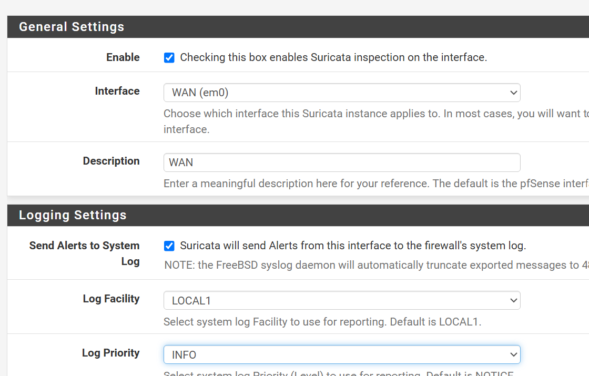
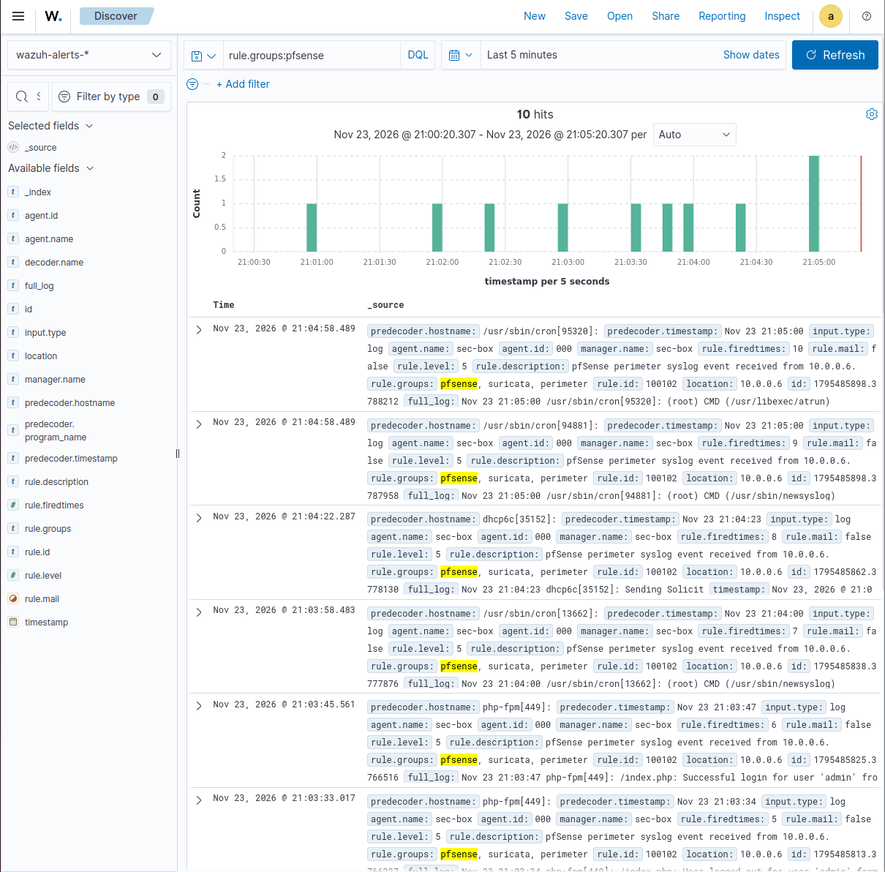
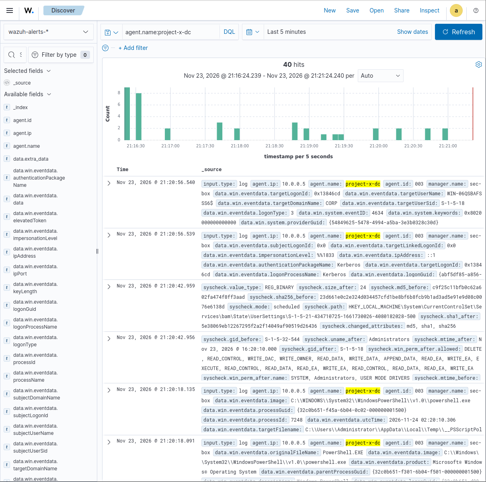

# Enterprise SIEM Integration: Unified Perimeter & Endpoint Telemetry (Wazuh, pfSense/Suricata & Windows Sysmon)

## Overview
This project demonstrates the end-to-end engineering of a centralized, enterprise-grade Security Information and Event Management (SIEM) architecture built entirely with open-source tools. By correlating agentless perimeter firewall and IPS logs from **pfSense and Suricata** with deep endpoint telemetry from a **Windows Server Active Directory Domain Controller running Sysmon**, this environment replicates a real-world Tier 1 and Tier 2 SOC visibility stack.

---

## Lab Architecture & Network Topology

| Hostname | Role | Operating System | IP Address | Telemetry Protocol / Port |
| :--- | :--- | :--- | :--- | :--- |
| **sec-box** | Wazuh Manager, Indexer & Dashboard (v4.9.2) | Ubuntu Linux | 10.0.0.10 | Receives Syslog (514/UDP) & Agent (1514/TCP, 1515/TCP) |
| **pfSense** | Edge Firewall & Suricata IPS | FreeBSD (pfSense) | 10.0.0.6 | Agentless BSD (RFC 3164) Syslog -> 10.0.0.10:514/UDP |
| **project-x-dc** | Active Directory Domain Controller (CORP) | Windows Server | 10.0.0.5 | Wazuh Agent (v4.9.2) + Sysmon -> 10.0.0.10:1514/TCP |

```text
[ pfSense + Suricata IPS (10.0.0.6) ] ──(BSD Syslog / UDP 514)──┐
                                                                ▼
                                               [ Wazuh SIEM on sec-box (10.0.0.10) ]
                                                                ▲
[ project-x-dc + Sysmon (10.0.0.5) ] ──(Wazuh Agent / TCP 1514)─┘
```

---

## Implementation Highlights

### 1. Perimeter Log Ingestion (pfSense & Suricata)
* Configured pfSense remote logging using **BSD (RFC 3164)** format to forward firewall (`filterlog`), web service (`nginx`/`php-fpm`), and **Suricata WAN IPS** alerts directly to the Wazuh Manager.
* Authored custom Wazuh detection rules in `/var/ossec/etc/rules/local_rules.xml` to classify baseline perimeter syslog traffic (Level 5) and escalate Suricata IPS alert or block events (Level 10):

```xml
<group name="pfsense,suricata,perimeter,">
  <rule id="100100" level="5">
    <decoded_as>pf</decoded_as>
    <description>pfSense firewall event logged ($(action)$(protocol) from $(srcip) to$(dstip)).</description>
  </rule>

  <rule id="100102" level="5">
    <location>10.0.0.6</location>
    <description>pfSense perimeter syslog event received from 10.0.0.6.</description>
  </rule>

  <rule id="100101" level="10">
    <if_sid>100100,100102</if_sid>
    <match>suricata|SURICATA|alert|ALERT|drop|DROP|block|BLOCK</match>
    <description>Suricata IPS alert or block event reported by pfSense perimeter.</description>
  </rule>
</group>
```

### 2. Endpoint Telemetry & Active Directory Monitoring (`project-x-dc`)
* Deployed **Microsoft Sysmon (`Sysmon64.exe`)** configured with the **SwiftOnSecurity** ruleset to capture granular process creation, command-line arguments, and file creation events.
* Enrolled `project-x-dc` into Wazuh (`agent.id: 003`) using a version-matched `4.9.2` Windows agent and extended `C:\Program Files (x86)\ossec-agent\ossec.conf` to ship the Sysmon operational channel:

```xml
<localfile>
  <location>Microsoft-Windows-Sysmon/Operational</location>
  <log_format>eventchannel</log_format>
</localfile>
```

---

## Real-World Engineering & Troubleshooting Notes
* **Packet Capture vs. Host Firewall (`tcpdump` / UFW):** Initial packet captures (`tcpdump -n -A -i any host 10.0.0.6 and udp port 514`) confirmed UDP syslog packets were arriving at `sec-box`, yet alerts were missing in Wazuh. Auditing `/var/ossec/logs/alerts/alerts.log` revealed Ubuntu's UFW was silently dropping incoming `514/UDP` traffic (`[UFW BLOCK]`) after `tcpdump` inspected the NIC. Opening `514/udp`, `1514/tcp`, and `1515/tcp` in UFW resolved ingestion immediately.
* **Syslog Header Scoping:** Packet inspection showed pfSense omitted the hostname token between the timestamp and program name (`Nov 23 20:52:27 php-fpm[449]: ...`). Scoping rule `100102` to `<location>10.0.0.6</location>` eliminated false positives from local `sec-box` `journald` kernel logs while capturing 100% of remote perimeter telemetry.

---

## Validation & Proof of Execution
* **Perimeter Verification:** Confirmed live `pfSense` telemetry in Wazuh Discover (`rule.groups:pfsense`, `location: 10.0.0.6`, `rule.id: 100102`).
* **Endpoint Detection Test:** Executed benign attacker-simulation commands (`whoami /all` and a Base64-encoded PowerShell command) on `project-x-dc`. Wazuh Discover recorded **40 live events** across three telemetry layers:
  1. **Sysmon:** `PowerShell.EXE` process creation (`processGuid`, `parentProcessGuid`) and temporary script policy file creation.
  2. **Windows Security / AD:** Kerberos authentication and Event ID `4634` (`logonType: 3`) within the `CORP` domain.
  3. **FIM / Registry Monitoring (`syscheck`):** Real-time registry modifications under `HKLM\System\CurrentControlSet\Services\bam\State\UserSettings`.

## Screenshots & Proof of Execution

### 1. UFW Firewall Configuration on sec-box


### 2. pfSense Perimeter Telemetry in Wazuh Discover


### 3. Windows Server DC & Sysmon Telemetry in Wazuh Discover

